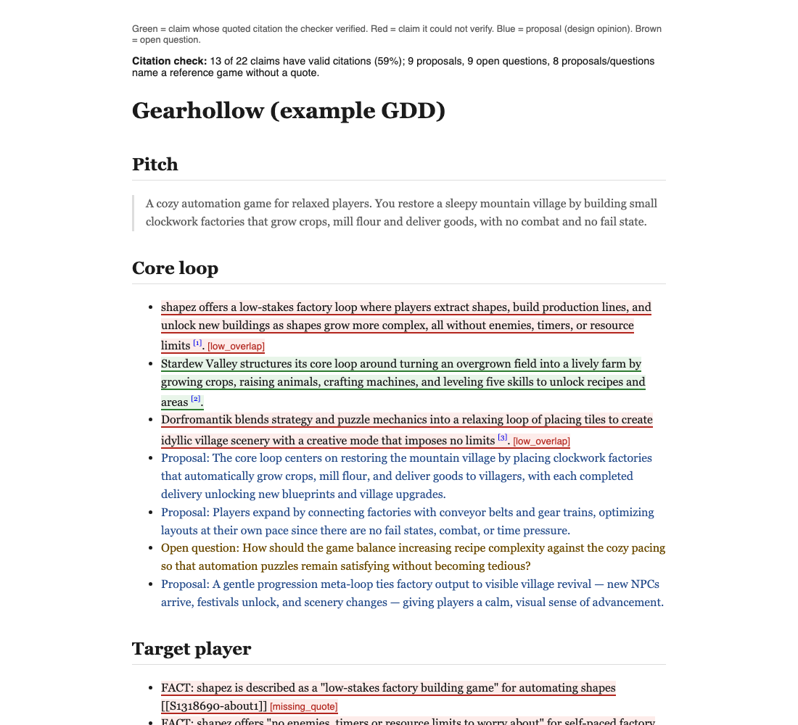

# gdd-copilot

Generate a game design document (GDD) from a short pitch. Every factual sentence about
reference games or the market must cite a quoted span from a stored source, and a checker
verifies each citation and flags the sentences it cannot verify. Design opinions are allowed,
but they must be labelled `Proposal:`.

## Try it

**Live examples (no install):** <https://oguzhanozfe.github.io/gdd-copilot/>. Three generated GDDs as
printable HTML, each labelled with the model that wrote it: Gearhollow by a cloud model
(`nvidia/nemotron-3-ultra-550b-a55b:free` on OpenRouter), and Tidebound and Gearhollow by a local
`qwen3.5:9b`. Verified claims are green, unverified claims red, and the citation-check report is at the
bottom of each page.

[](https://oguzhanozfe.github.io/gdd-copilot/openrouter-nemotron-3-ultra/gearhollow/gdd.html)

```bash
python -m gdd_copilot demo        # no API key, no dependencies; writes demo-out/index.html
```

`demo` builds the bundled pitches from the committed Steam snapshots and runs the citation checker. It
picks the model automatically: a cloud key in the environment (`GEMINI_API_KEY`, `DEEPSEEK_API_KEY`,
`OPENROUTER_API_KEY`),
else a local Ollama that has `qwen3.5:9b` (or `GDD_MODEL`), else **replay** of the recorded responses in
`examples/<model>/<pitch>/recorded/` (all three runs). It prints which one it used, e.g.
`mode: replay (recorded qwen3.5:9b, 2026-11-17)`. If a live call fails (quota, timeout), that section is
replayed and the run says so. Replay reproduces the committed `gdd.raw.md` files exactly, and CI checks that.
Keys are optional; see [Run it](#run-it) to use a real model.

## Why

LLM-written design docs read well and invent things freely: sales numbers, features that a
reference game does not have, the wrong publisher. In a GDD those inventions turn into
decisions. This project treats a GDD as two kinds of text, **evidence** and **proposals**,
and makes the evidence checkable by machine.

## How it works

```
Steam appdetails ─┐                         ┌─ gdd.raw.md  (inline [[id: "quote"]] citations)
                  ├─ chunks ─ BM25 ─ LLM ───┤
team notes (.md) ─┘   (per section)         └─ checker ─ check.md / check.json
                                                   └─ gdd.md (numbered sources) + gdd.html (flags in red)
```

1. **Corpus** (`gdd_copilot/fetch.py`, `corpus.py`). Snapshots of the public Steam store
   `appdetails` API for the chosen reference games are stored in `corpus/steam/<appid>.json`,
   each with its source URL and retrieval time. User notes in Markdown (`corpus/notes/`)
   are split into one chunk per bullet. The fetcher checks `robots.txt`, waits 2 s between
   requests and does not store reviewer identities.
2. **Retrieval**. Stdlib BM25 per GDD section. The facts chunk of each reference game is
   always included for the "Reference games" and "Monetization" sections. The related public
   repo [evidence-rag](https://github.com/oguzhanozfe/evidence-rag) does heavier
   evidence-preserving retrieval; this project keeps a small BM25 so it stays stdlib-only.
3. **Generation** (`generate.py`). One model call per section (core loop, target player,
   reference games, monetization, risks, open questions). Each bullet must be one of three
   kinds: a fact ending in `[[CHUNK_ID: "exact words"]]`, a `Proposal:`, or an `Open question:`.
4. **Checker** (`check.py`). Each claim is checked in this order:
   chunk id exists → quote occurs verbatim in that chunk (case, whitespace, curly quotes and
   edge punctuation normalised) → every number in the claim appears in the cited chunk →
   every reference-game name in the claim appears in the cited chunk → at least 50% of the
   claim's content words appear in the cited chunk. A sentence that is not a proposal or
   question and has no citation is `uncited`. Proposals and questions that name a reference
   game without a quote get a warning.
5. **Render** (`render.py`). Markdown with numbered sources (URL and retrieval date), and
   print-ready HTML in which verified claims are green, unverified claims are red, and the
   citation-check report is appended.

## Run it

Python 3.10+, no dependencies.

```bash
python -m unittest discover -s tests -v                      # offline tests
python -m gdd_copilot demo                                   # best available model, or replay of all recorded runs
python -m gdd_copilot check pitches/tidebound.json --out examples/ollama-qwen3.5-9b/tidebound   # re-check a committed GDD
python -m gdd_copilot bench examples/ollama-qwen3.5-9b/*/gdd.raw.md                              # planted-claim benchmark (no model calls)
```

Generating a new GDD needs a model. The provider is picked in this order: `GDD_PROVIDER` if
set, else Gemini when `GEMINI_API_KEY` is set, else DeepSeek when `DEEPSEEK_API_KEY` is set, else OpenRouter when
`OPENROUTER_API_KEY` is set (default model `nvidia/nemotron-3-ultra-550b-a55b:free`), else a local Ollama at `OLLAMA_HOST` (default `http://127.0.0.1:11434`). `GDD_MODEL` overrides
the model; `GDD_PROVIDER=openai` with `OPENAI_API_KEY` / `OPENAI_BASE_URL` works for any
OpenAI-compatible endpoint.

```bash
GDD_PROVIDER=ollama GDD_MODEL=qwen3.5:9b python -m gdd_copilot generate pitches/tidebound.json --out out/tidebound
GDD_PROVIDER=openrouter python -m gdd_copilot generate pitches/gearhollow.json --out out/gearhollow
python -m gdd_copilot fetch 646570 2379780     # refresh Steam snapshots (network)
```

A pitch file is JSON: `title`, `pitch`, `refs` (Steam app ids) and `notes` (Markdown paths).
Each finished section is cached under `<out>/.cache/`, so a rerun after a timeout only
repeats the missing sections. HTTP errors such as 429 (quota) are not retried.

## Results

All numbers below come from files committed in `examples/`.

**Which model produced what.** All three GDDs were generated on 2026-11-17, and the model is
recorded at the bottom of each `gdd.raw.md` and shown on each HTML page:

- `examples/ollama-qwen3.5-9b/{tidebound,gearhollow}`: `qwen3.5:9b` (Q4_K_M, Ollama digest
  `56671c2ab938`) running locally.
- `examples/openrouter-nemotron-3-ultra/gearhollow`: `nvidia/nemotron-3-ultra-550b-a55b:free` on
  OpenRouter's free tier (6 calls, 10,285 prompt + 11,439 completion tokens). Only one pitch was run on
  it to stay inside the shared daily free-tier cap.

Earlier cloud attempts the same day (Gemini `gemma-4-31b-it`, `gemini-3.5-flash-lite`) returned
429/503 on the shared free-tier quota, and DeepSeek had no balance, so they are not included.

### 1. Share of claims with valid citations (real runs)

| GDD | Claims | Valid citation | Share | Failure reasons | Proposals | Open questions |
| --- | --- | --- | --- | --- | --- | --- |
| [Tidebound](examples/ollama-qwen3.5-9b/tidebound/check.md) (roguelike deckbuilder) | 9 | 7 | 78% | 2 × missing_quote | 12 | 11 |
| [Gearhollow](examples/ollama-qwen3.5-9b/gearhollow/check.md) (cozy automation) | 16 | 5 | 31% | 11 × missing_quote | 9 | 11 |
| qwen3.5:9b, both | 25 | 12 | 48% | 13 × missing_quote | 21 | 22 |
| [Gearhollow, nemotron-3-ultra](examples/openrouter-nemotron-3-ultra/gearhollow/check.md) | 22 | 13 | 59% | 5 × missing_quote, 2 × low_overlap, 1 × quote_not_found, 1 × number_mismatch | 9 | 9 |

The two Gearhollow rows use the same pitch, corpus and prompts, so they compare the models directly
(one run each, so treat the gap as indicative).

Every qwen3.5:9b failure is the same one: the 9B model wrote `[[S427520-about1]]` without
the quoted span. No quote was fabricated, and no wrong id was cited. The model mostly avoided
facts by writing proposals and questions, and 17 of those name a reference game without
evidence (the `non_claim_warnings` field in `check.json`).

The larger cloud model stated more facts and made more kinds of mistakes, which the checker caught:
a "quote" spliced from two places with "..." (`quote_not_found`), "Factorio launched at $35.00"
citing a chunk that has no price (`number_mismatch`; the price is in a different chunk, and "launched
at" is not supported anyway), and five `FACT:` bullets that put the id after the quote instead of
inside the citation (`missing_quote`).

**Is "supported" actually right?** One person read the 12 supported qwen3.5:9b claims against
their sources (the 13 nemotron claims are not audited) ([manual-audit.md](examples/manual-audit.md)): 11 were faithful. The miss says Slay the
Spire cost $24.99 "when it released". The chunk has the current price and the release date as
separate facts, and the checker can't tell the difference.

### 2. Checker catch rate on planted unsupported claims

`bench` plants known-false claims, built from the Steam snapshots, into a real GDD and checks
the whole document. The run used 8 claims per category (one per reference game), planted
into each of the two GDDs. It also plants 32 true, correctly cited control claims to measure
false alarms. Source: [bench-planted-claims.json](examples/bench-planted-claims.json).
The checker makes no model calls, so these rates don't depend on a model. The planted claims
were inserted into the two `qwen3.5:9b` GDDs above, and both gave identical results.

| Planted claim type | Example | Caught |
| --- | --- | --- |
| Uncited fact | "X sold more than 3 million copies in its first year." | 16/16 |
| Fabricated quote | quote not present in the cited chunk | 16/16 |
| Non-existent chunk id | `[[S646570-dev: ...]]` | 16/16 |
| Wrong number | recommendations doubled, real quote cited | 16/16 |
| Wrong game | game A's developer attributed to game B | 16/16 |
| Off-topic citation | "has a full map editor" citing the developer line | 16/16 |
| Wrong publisher | another game's publisher, citing the real publisher line | 16/16 |
| **Inversion** | "X does not run on windows" citing "Platforms: windows, mac" | **0/16** |
| **Total planted** | | **112/128 (87.5%)** |
| True controls falsely flagged | | 0/64 |

The checker is lexical. It catches citations that don't exist, don't match or point at the
wrong thing. It does **not** understand meaning: negation, a wrong time frame (the $24.99
example) and other paraphrases that keep the source's words still pass. The benchmark claims
are templated, so these rates describe these error types on this corpus, not arbitrary
model errors.

## Known limits

- **Semantic support is not checked.** See inversion (0%) and the manual audit. An NLI model
  or LLM judge on top of the lexical checks is the obvious next step; it was left out to keep
  the checker deterministic and offline.
- **No Steam review data.** The `appreviews` endpoint (allowed by robots.txt) redirected every
  request to the store homepage on 2026-11-17, so the snapshots record
  `"reviews": null` with a note. The fetcher and chunker support reviews when the endpoint
  answers; no attempt was made to work around the refusal.
- **Store text is marketing copy.** Facts like "Over 220 cards" are what the publisher says
  on the store page, cited as such, not independently verified.
- **Small sample.** Three GDDs from two models, one run each. The citation share differs by model
  (31% vs 59% on the same Gearhollow pitch); rerun `generate` with another `GDD_MODEL` to compare.
- **Team notes are examples.** `corpus/notes/*.md` were written for this repo to stand in for
  a real team's notes; they contain project constraints, not market data.
- The number check ignores units. "$24.99" and "24.99 hours" look the same to it.

## Layout

```
gdd_copilot/   fetch.py corpus.py generate.py check.py render.py bench.py __main__.py
corpus/        steam/<appid>.json snapshots, notes/*.md
pitches/       tidebound.json gearhollow.json
examples/      <model>/<pitch>/{gdd.raw.md,gdd.md,gdd.html,check.md,check.json,recorded/}
               (ollama-qwen3.5-9b: tidebound, gearhollow; openrouter-nemotron-3-ultra: gearhollow)
               bench-planted-claims.json manual-audit.md
tests/         offline unittest suite
docs/          README screenshot (the Pages site is built by .github/workflows/pages.yml from `demo`)
```

Steam data © its respective publishers, stored as short snapshots for citation. MIT licence
for the code.
